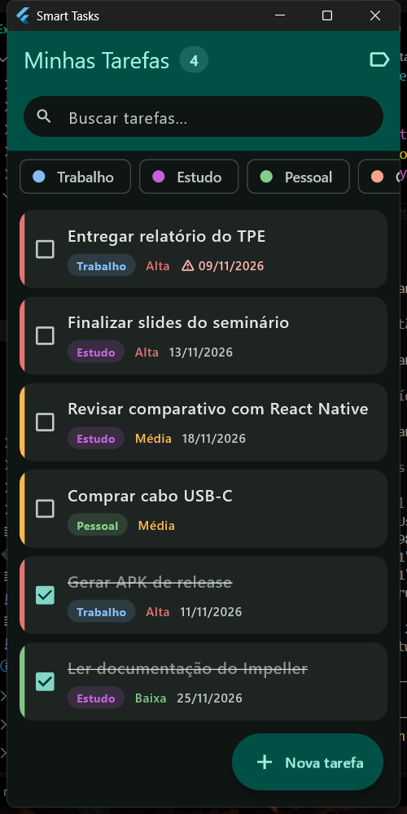
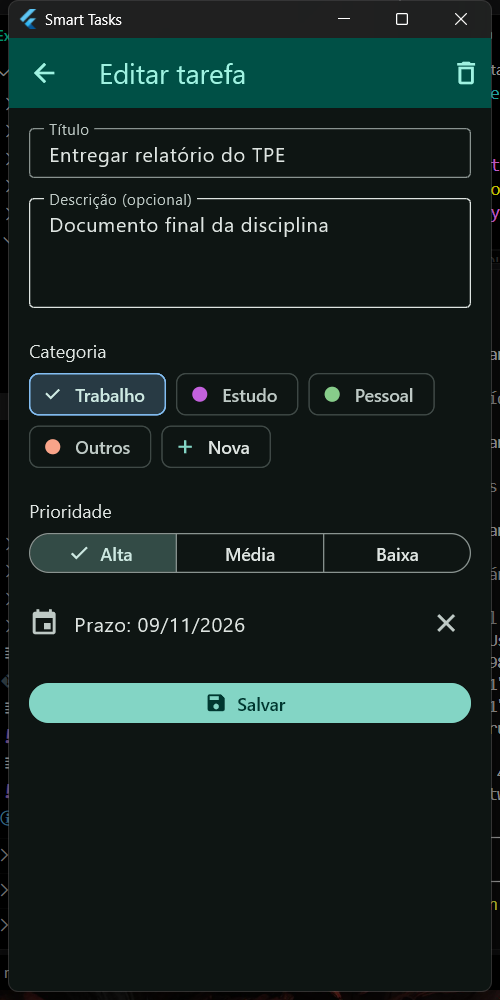
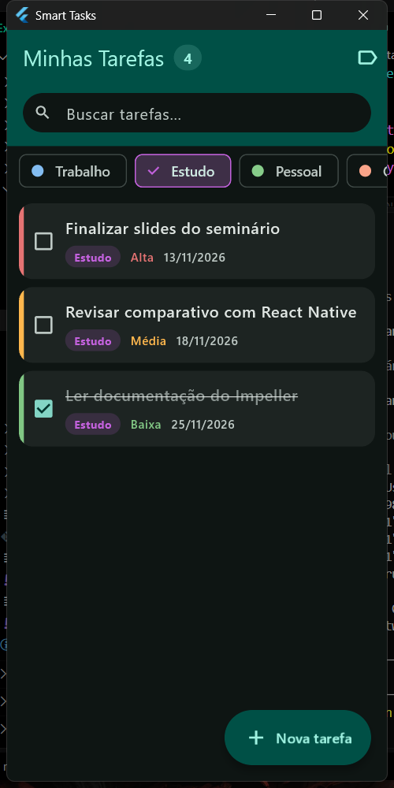
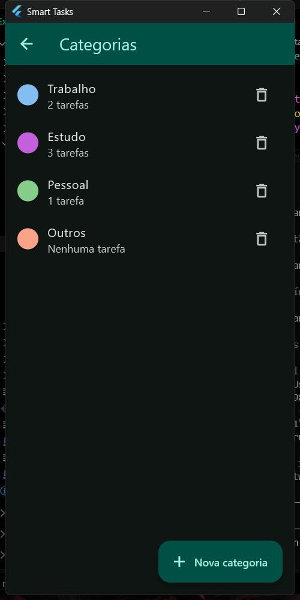
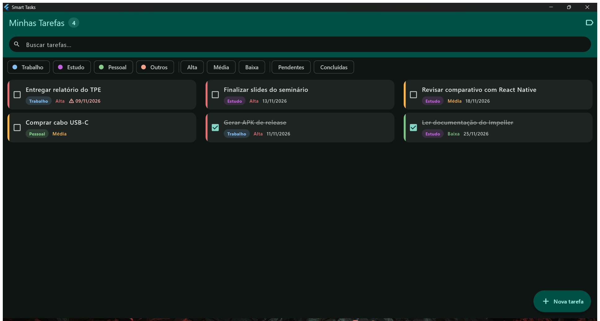

# Smart Tasks

Gerenciador de tarefas inteligente desenvolvido em **Flutter**, para a disciplina
*Explorando Tecnologias Móveis* (Unochapecó — prof. Cezar Junior de Souza).

O aplicativo vai além de uma lista de afazeres: ele **reorganiza as tarefas sozinho**,
destacando o que está atrasado e o que é mais urgente, sem que o usuário precise ordenar
nada manualmente.

## Funcionalidades

### Obrigatórias

- **Criar, editar e excluir tarefas** — formulário com validação de título; edição ao tocar
  na tarefa; exclusão por deslize lateral ou pelo botão dentro da edição
- **Categorias** — Trabalho, Estudo, Pessoal e Outros vêm prontas, mas são apenas o ponto
  de partida: o usuário cria, renomeia e exclui as próprias categorias
- **Prioridades** — Alta, Média e Baixa, com indicador colorido em cada item
- **Marcar como concluída** — caixa de seleção que risca o título e reposiciona a tarefa
- **Buscar e filtrar** — busca por título *e* descrição, combinada com filtros de categoria,
  prioridade e situação
- **Persistência local** — os dados sobrevivem ao fechamento do app, via `shared_preferences`

### Diferenciais "inteligentes"

- **Ordenação automática** — a lista se reordena sozinha seguindo esta hierarquia:

  1. Pendentes antes de concluídas
  2. Atrasadas no topo
  3. Prioridade (Alta → Média → Baixa)
  4. Prazo mais próximo primeiro

- **Destaque de tarefas atrasadas** — ícone de alerta e texto em vermelho para prazos vencidos
- **Contador de pendentes** — exibido no título da tela, atualizado em tempo real
- **Desfazer exclusão** — deslizar é fácil de disparar sem querer, então a tarefa excluída
  volta pelo botão "Desfazer" do aviso
- **Categorias do usuário** — criadas pela tela de categorias ou direto do formulário, sem
  interromper o cadastro. Uma categoria com tarefas não pode ser excluída, o que impede
  deixar tarefas órfãs

### Identidade visual

- **Tema claro e escuro** — acompanha a configuração do sistema
- **Paleta derivada de uma única cor** — todo o esquema do Material 3 nasce da cor-semente
  definida em `lib/theme.dart`; trocá-la repinta o app inteiro de forma coerente
- **Ícone próprio** — em todas as densidades do Android, com ícone adaptativo (Android 8+)
  e tela de abertura na mesma identidade

## Telas

### Lista de tarefas

A ordenação inteligente em ação: a tarefa atrasada aparece em vermelho no topo, seguida pelas
pendentes por prioridade e prazo; a concluída fica por último, riscada.



### Cadastro e edição

Cada categoria tem a própria cor, e o chip "Nova" cria uma categoria sem sair do formulário:



### Busca e filtros

Filtro de categoria "Estudo" aplicado:



### Categorias

As quatro categorias de fábrica são só o ponto de partida — dá para criar, renomear e
recolorir. O contador de uso explica por que uma categoria com tarefas não pode ser excluída:



### Layout responsivo

O mesmo código, numa janela de desktop maximizada: o número de colunas vem da largura
disponível, em vez de uma faixa estreita de conteúdo no meio da tela.



## Como rodar o projeto

Pré-requisitos: [Flutter SDK](https://docs.flutter.dev/get-started/install) 3.13 ou superior.

```bash
git clone https://github.com/bdalpaz/smart-tasks-flutter.git
cd smart-tasks-flutter
flutter pub get
flutter run
```

Para escolher a plataforma:

```bash
flutter devices              # lista os dispositivos disponíveis
flutter run -d windows       # desktop
flutter run -d chrome        # navegador
flutter run -d <id-android>  # celular ou emulador
```

## Testes

```bash
flutter test
```

São 60 testes de unidade cobrindo as regras que não aparecem na interface:

- **Ordenação inteligente** — cada critério da hierarquia é verificado isoladamente,
  inclusive o desempate (uma tarefa atrasada de prioridade baixa fica acima de uma de
  prioridade alta no prazo)
- **Busca e filtros** — busca por título e por descrição, indiferente a maiúsculas, e a
  combinação acumulativa com os três filtros
- **Categorias** — nomes repetidos recusados, renomear sem reescrever tarefa alguma, e as
  duas regras que protegem os dados (não excluir categoria em uso nem a última restante)
- **Persistência** — as tarefas sobrevivem a uma nova instância do provider, e um JSON
  corrompido ou gravado por uma versão anterior do modelo resulta em lista vazia em vez de
  impedir a abertura do app
- **Compatibilidade** — uma tarefa gravada pela versão em que a categoria era `enum`
  continua sendo lida corretamente

## Build e APK

```bash
flutter build apk --release
```

O arquivo é gerado em `build/app/outputs/flutter-apk/app-release.apk` (~50 MB).

**Download:** veja a [Release v1.1](https://github.com/bdalpaz/smart-tasks-flutter/releases/tag/v1.1).

> O APK é assinado com a chave de depuração padrão do Flutter, o que é suficiente para
> instalar e testar no dispositivo. Para publicação em loja seria necessário configurar uma
> chave de assinatura própria.

## Estrutura do projeto

```
lib/
├── main.dart                        # ponto de entrada
├── theme.dart                       # cor-semente, temas claro/escuro e cores de prioridade
├── layout_responsivo.dart           # quantas colunas cabem e quanto o conteúdo ocupa
├── models/
│   ├── tarefa.dart                  # modelo, serialização JSON e regra de "atrasada"
│   └── categoria.dart               # categoria como dado, com as padrão de fábrica
├── providers/
│   └── tarefa_provider.dart         # estado, filtros, busca, ordenação e CRUD de categorias
├── data/
│   ├── tarefa_repository.dart       # persistência das tarefas
│   └── categoria_repository.dart    # persistência das categorias
└── screens/
    ├── lista_tarefas_screen.dart    # tela principal, filtros e grade de cartões
    ├── form_tarefa_screen.dart      # cadastro e edição
    ├── categorias_screen.dart       # criar, renomear e excluir categorias
    └── dialogo_categoria.dart       # diálogo de nome e cor, usado pelas duas telas

test/
├── tarefa_test.dart                 # modelo: "atrasada", serialização e dados antigos
├── tarefa_provider_test.dart        # ordenação, busca, filtros, categorias e persistência
└── layout_responsivo_test.dart      # invariantes do layout em qualquer largura
```

A separação segue a ideia de camadas: a **tela** só desenha e dispara ações, o **provider**
concentra as regras de negócio e notifica a interface, e o **repositório** cuida do
armazenamento. Trocar `shared_preferences` por um banco local exigiria mexer em um único
arquivo.

## Tecnologias utilizadas

| Recurso | Uso no projeto |
|---|---|
| [Flutter](https://flutter.dev) 3.x / Dart | Framework e linguagem |
| [Material 3](https://m3.material.io/) | Design system da interface |
| [provider](https://pub.dev/packages/provider) `^6.1.5` | Gerenciamento de estado (`ChangeNotifier`) |
| [shared_preferences](https://pub.dev/packages/shared_preferences) `^2.5.6` | Persistência local em JSON |

## Dificuldades enfrentadas

O registro dos problemas de configuração e build encontrados durante o desenvolvimento, com
causa e solução de cada um, está em [`docs/dificuldades.md`](docs/dificuldades.md).

## Seminário

A apresentação está dividida nos quatro blocos pedidos pelo trabalho:

| Bloco | Conteúdo | Apresenta |
|---|---|---|
| A | Introdução ao Flutter | Alice Dal Paz |
| B | Processo de desenvolvimento | Anthony Cazuni |
| C | Build e deploy | Gabriel Ferri |
| D | Comparativo com React Native | João Vitor Canello |

## Integrantes

- Alice Dal Paz
- Anthony Cazuni
- Gabriel Ferri
- João Vitor Canello

## Licença

Projeto acadêmico, sem fins comerciais.
